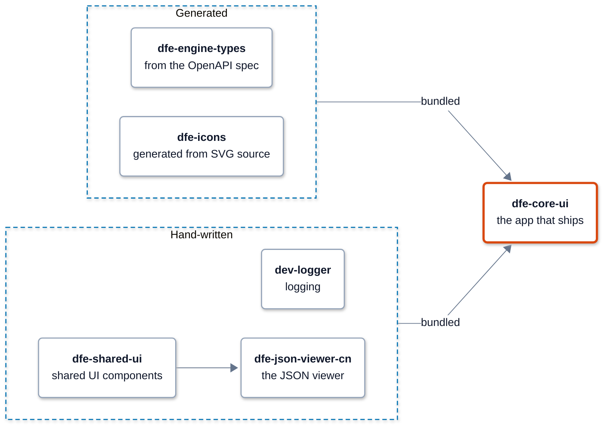

# Contributing

We welcome contributions to this project. By contributing, you agree to the
terms outlined below.

To run the console locally against a local dfe-engine, see
[docs/local-development.md](docs/local-development.md).

## Commit Message Format

HyperI projects use [Conventional Commits](https://www.conventionalcommits.org/)
and [semantic-release](https://semantic-release.gitbook.io/) for automated
versioning and changelog generation. All commits must follow this format:

```text
<type>(<scope>): <subject>

[optional body]

[optional footer(s)]
```

### Types

| Type       | Description                                             | Version Bump  |
| ---------- | ------------------------------------------------------- | ------------- |
| `feat`     | A new feature                                           | Minor (0.X.0) |
| `fix`      | A bug fix                                               | Patch (0.0.X) |
| `docs`     | Documentation only                                      | None          |
| `style`    | Code style (formatting, semicolons, etc.)               | None          |
| `refactor` | Code change that neither fixes a bug nor adds a feature | None          |
| `perf`     | Performance improvement                                 | Patch (0.0.X) |
| `test`     | Adding or correcting tests                              | None          |
| `build`    | Changes to build system or dependencies                 | None          |
| `ci`       | Changes to CI configuration                             | None          |
| `chore`    | Other changes that don't modify src or test files       | None          |
| `revert`   | Reverts a previous commit                               | Varies        |

For breaking changes that require a major version bump, add `!` after the type
or include `BREAKING CHANGE:` in the footer:

```text
feat!: remove deprecated API endpoints

BREAKING CHANGE: The /v1/users endpoint has been removed. Use /v2/users instead.
```

Examples:

```text
feat(auth): add OAuth2 support for Google login

fix(api): handle null response from upstream service

docs: update installation instructions for Windows

refactor(core)!: restructure module exports

BREAKING CHANGE: Named exports are now used instead of default exports.
```

Scope is optional but recommended. Use it to indicate the area of the codebase
affected (e.g., `api`, `auth`, `core`, `cli`, `docs`).

This project follows [Semantic Versioning 2.0.0](https://semver.org/):

- MAJOR (X.0.0): Breaking changes that require users to modify their code
- MINOR (0.X.0): New features that are backwards-compatible
- PATCH (0.0.X): Bug fixes and minor improvements

Versions are automatically determined by semantic-release based on commit
messages. Do not manually update version numbers.

## License for Contributions

All contributions to this project are licensed under the Business Source
License 1.1 (BUSL-1.1), the same license that covers the project.

Each version of the software (including your contributions) will automatically
become available under the Apache License, Version 2.0 on the third
anniversary of its release.

## How to Contribute

1. **Fork the repository** and create your branch from `main`
2. **Make your changes** following the commit message format above
3. **Test your changes** to ensure they work as expected
4. **Submit a pull request** with a clear description of what you've done

Before you open it:

- [ ] Commits follow the conventional commit format
- [ ] Tests pass (if applicable)
- [ ] Documentation is updated (if applicable)

## Run the checks locally before you push

HyperI projects gate every push through CI (lint, format, tests, secret scan,
dependency audit, build). Run the SAME checks locally first so your change lands
green instead of bouncing:

```bash
hyperi-ci check
```

`hyperi-ci` is the HyperI CI CLI (public on PyPI). If you do not have it, install
it once with `uv tool install hyperi-ci` (or `pipx install hyperi-ci`), or run it
ad hoc with `uvx hyperi-ci check`. It runs the project's full local validation --
the same suite CI runs -- and reports what to fix. Run it before every push and before opening a
pull request.

## CI/CD Workflow

When your pull request is merged to `main`:

1. **semantic-release** analyses commit messages since the last release
2. Determines the next version number based on commit types
3. Generates/updates the CHANGELOG
4. Creates a new GitHub release with release notes
5. Publishes the package (if applicable)

This happens automatically - no manual intervention required. A question about contributing goes in an issue.

## Context

### What this is

The operator console: a Next.js app that reads and writes through one backend, the dfe-engine API, and frames the dfe-hyperdx fork for data exploration. It keeps no datastore. When the console needs data the engine grows an endpoint, rather than the UI reaching past it.

Not an internal tool. Other organisations run this console against their engines, so cluster names, fleet details and credential paths belong in each deployment's private config repo. One artifact ships, the `ghcr.io/hyperi-io/dfe-ui` container.

The console is one of the suite's user-facing components, with dfe-receiver and dfe-hyperdx, so an advisory here is graded on reachability before severity. The exposure model is declared once, in dfe-infra:
<https://github.com/hyperi-io/dfe-infra/blob/main/docs/threat-model.md>

### Where things live

| Path                                                                                                       | Holds                                                                                                                                                  |
| ---------------------------------------------------------------------------------------------------------- | ------------------------------------------------------------------------------------------------------------------------------------------------------ |
| `apps/dfe-core-ui`                                                                                         | the only workspace that ships -- Next standalone output                                                                                                |
| `src/app`                                                                                                  | route groups `(auth)`, `(no-auth)`, plus unauthenticated `livez`, `readyz`, `metrics`                                                                  |
| `src/proxy.ts`                                                                                             | Next 16 middleware (renamed `middleware` -> `proxy`): auth guard, setup redirect, and the `dfe_token` cookie the dfe-hyperdx iframe authenticates with |
| `src/core/config/api`                                                                                      | the one typed engine client, and the endpoint map compile-checked against the generated `paths`                                                        |
| `src/core/components/RbacProtected`                                                                        | scope gating, for routes and for single buttons                                                                                                        |
| `src/{AdminTools,Apps,Hunts,Library,Platform,Rules,Schemas,Settings,Sources,Usage,_FieldMaps,_Transforms}` | one directory per console domain, each with its own query hooks                                                                                        |
| `e2e/`                                                                                                     | Playwright specs -- they drive a running console against a running engine                                                                              |
| `packages/dfe-engine-types/`                                                                               | byte copies of the engine's OpenAPI specs, and the types, scopes and limits generated from them                                                        |
| `packages/dfe-icons`                                                                                       | SVG -> React codegen, `generate:check` is its drift gate                                                                                               |

Paths under `apps/dfe-core-ui/` are shown relative to it.

Five workspace packages are bundled into the one app that ships.



_Figure 1. L4 Detail -- Workspace packages. dfe-core-ui is the app that ships._ Up: [L3 Components -- dfe-ui](docs/architecture.md).

`dfe-engine-types` is generated from the engine's OpenAPI spec and `dfe-icons` from SVG source. The sixth package, `typescript-config`, is the tsconfig the four React and logging packages extend, and nothing of it reaches the bundle. `dfe-core-ui` alone ships, as Next standalone output in a three-stage Dockerfile ([docs/build-and-deploy.md](docs/build-and-deploy.md)). No package is published by itself.

### Commands that prove a change

```bash
yarn lint                            # eslint only -- it does NOT typecheck
yarn check-types                     # tsc --noEmit, a separate turbo task
yarn test                            # vitest run, apps/dfe-core-ui only
yarn build                           # next build -- catches what `yarn dev` will not
yarn format:check                    # prettier over the tree, README included
yarn check:icons                     # icon codegen drift
make check                           # hyperi-ci check, what CI runs
yarn workspace dfe-core-ui test:e2e  # Playwright, needs a console and an engine up
```

The Playwright suite's setup is [apps/dfe-core-ui/e2e/README.md](apps/dfe-core-ui/e2e/README.md), and running natively on a Mac is in [docs/local-development.md](docs/local-development.md).

### What tends to bite

| Don't                                                                         | Do                                                                                           | Why                                                                                                                                                              |
| ----------------------------------------------------------------------------- | -------------------------------------------------------------------------------------------- | ---------------------------------------------------------------------------------------------------------------------------------------------------------------- |
| hand-patch a generated type to add a field the engine spec copy lacks         | copy the engine spec again, then `yarn workspace @repo/dfe-engine-types generate`            | #298: a hand patch kept a stale spec alive after the engine made the field required                                                                              |
| re-derive what the engine already declares -- a picker's options, a name rule | read the engine's list, carry the engine's rule                                              | #287, the engine picker was hardcoded and offered an engine that does not exist. #218, the form allowed `aws_cloudtrail` where the engine wants a DNS-1123 label |
| put a health or metrics route behind `withAuth`                               | keep `livez`, `readyz`, `metrics` in the `proxy.ts` matcher exclusions                       | probes carry no session, so `withAuth` returned 307 to `/login`. Kubernetes counts 3xx as success, so probes passed while the app was face down                  |
| read a failed engine call as a completed state                                | tell a broken config apart from an unreachable engine                                        | #236, `proxy.ts` treated a failed setup-status call as setup complete                                                                                            |
| run the Playwright specs in parallel                                          | leave `fullyParallel: false` and `workers: 1`                                                | every spec shares one engine and calls `reset_all`. Workers race on seed-static, so a spec passes alone and hangs with the folder                                |
| add a per-file timeout when a `findBy` backstop expires                       | rely on the global `testTimeout: 20_000`                                                     | four suites died at vitest's 5s default on 4cpu runners, carrying 15s backstops the per-test budget beheads                                                      |
| lower `npmMinimalAgeGate` in `.yarnrc.yml` to land a CVE fix                  | pre-approve the exact locator in `npmPreapprovedPackages`, or `yarn add --no-time-gate` once | the gate applies at install and has no CVE exception, unlike Renovate's cooldown, so an early security PR fails with YN0016 "quarantined" (#129)                 |
| merge a `feat:` with the GitHub squash button                                 | default to `fix:`                                                                            | #209, the validator wants `HYPERCI_ALLOW_FEAT=1` set at commit time and the squash button has no environment. Main was red from 2026-09-03                       |

### Where this sits

Both edges are declared data -- read them with
`dfe-stack suite --consumer dfe-ui` and `--producer dfe-ui`.

dfe-engine -> dfe-ui is inbound, with two edges. This repo commits byte copies of the engine's `openapi/openapi.json` and `openapi/openapi.e2e.json`, so drift is measurable by hashing both copies, and dfe-engine's Sync dfe-engine-types workflow copies them here by pull request on a push to its main. An engine API change arrives here on its own. The second edge is derived: `packages/dfe-engine-types/scopes/index.ts` is written from the `RbacScope` enum in that spec by `yarn workspace @repo/dfe-engine-types generate`. A hand edit to either is drift.

dfe-ui -> dfe-infra is outbound and lockstep. dfe-infra's `versions.yaml` pins the container this repo publishes, as a tag plus the digest that makes the tag immutable, and the thin chart published at that tag. `check_versions_drift.py` holds every copy of the pin to it. It is the one repo a release here moves.

dfe-hyperdx is a runtime link only. `/observe` frames the fork on its own subdomain, which authenticates the operator from the `dfe_token` cookie `apps/dfe-core-ui/src/proxy.ts` plants on the shared parent domain (`DFE_COOKIE_DOMAIN`). The suite graph declares no build edge -- nothing here is generated from that repo or pinned to it.
