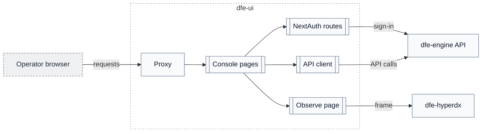
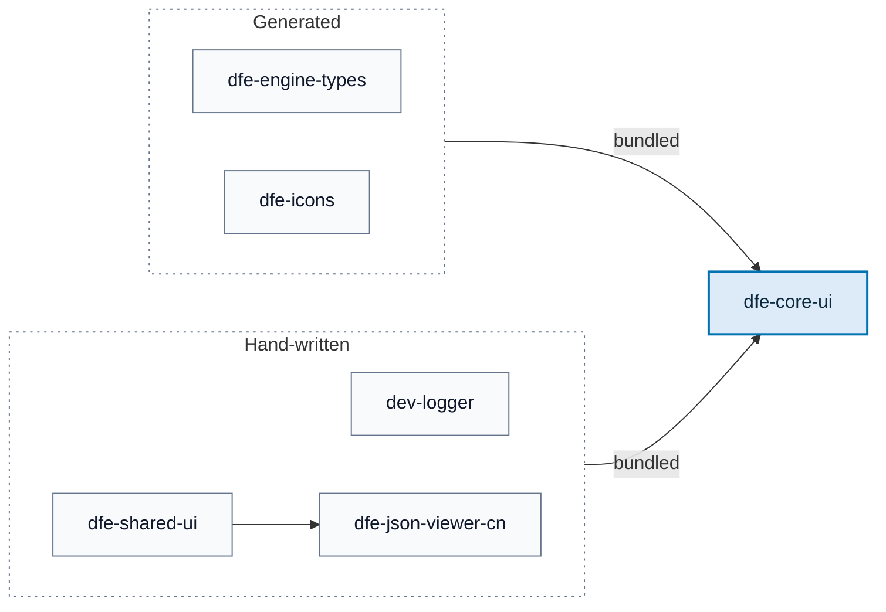

# dfe-ui architecture

dfe-ui is the operator console of the DFE suite: a Next.js app that talks to one backend, the dfe-engine API, and frames dfe-hyperdx for data exploration. It has no datastore: what it shows and changes goes through engine endpoints, Observe content comes from dfe-hyperdx, and the browser keeps preferences such as the theme in local storage. The console exposes the well-trodden part of the engine API and never reaches past it. When the console needs data, the engine grows an endpoint.

## The console is five parts

The browser reaches the console through the proxy, and the console reaches the engine through the NextAuth routes and the typed API client.

*Figure 1. L3 Components -- dfe-ui. The dashed box is external.* Up: top of dfe-ui. Down: [L4 Detail -- Console menu groups](console-and-the-flow.md), [L4 Detail -- Source flow card](console-and-the-flow.md#the-source-page-draws-the-engines-flow-resolver), [L4 Detail -- OIDC sign-in](authentication.md#sign-in-goes-through-the-engine), [L4 Detail -- Engine API client](engine-api-client.md#the-spec-becomes-typed-calls), [L4 Detail -- Observe embed](observe-embed.md), [L4 Detail -- Uploaded row lifecycle](create-schema-form.md#how-a-row-moves-from-import-to-submit).

| Part            | Code                                                                                    | Does                                                                                                                                                                                                  |
| --------------- | --------------------------------------------------------------------------------------- | ----------------------------------------------------------------------------------------------------------------------------------------------------------------------------------------------------- |
| Proxy           | `apps/dfe-core-ui/src/proxy.ts`                                                         | Guards the signed-in pages, sends an account on an issued password to the password change and an incomplete setup to the wizard, plants the `dfe_token` cookie and sets the Content-Security-Policy. |
| Console pages   | `apps/dfe-core-ui/src/app`, one feature directory per domain                            | Route group `(auth)` for the signed-in app, and `(no-auth)` for login, first-run setup, the forced password change and the engine-unavailable page.                                                   |
| NextAuth routes | `apps/dfe-core-ui/src/app/api/auth/[...nextauth]/route.ts`, `apps/dfe-core-ui/src/core/config/auth.ts` | Sign-in, session renewal and sign-out against the engine ([authentication.md](authentication.md)).                                                                                       |
| API client      | `apps/dfe-core-ui/src/core/config/api`                                                  | The one typed client feature code calls the engine through, with TanStack Query hooks per endpoint ([engine-api-client.md](engine-api-client.md)).                                                     |
| Observe page    | `apps/dfe-core-ui/src/app/(auth)/observe/[[...feature]]/page.tsx`                       | Frames dfe-hyperdx in chromeless mode ([observe-embed.md](observe-embed.md)).                                                                                                                         |

On a signed-in page the proxy checks the session, then the forced password change, then asks the engine for the setup status, and rewrites the request to the engine-unavailable page when the engine does not answer. The NextAuth, health and metrics routes skip the proxy. Feature code makes no raw fetch. The calls that skip the client all run on the server: the NextAuth sign-in and session helpers, and the `getAuthPermissions` and `getSetupStatus` server actions.

## One app ships, built from six packages

Five workspace packages are bundled into the one app that ships.

*Figure 2. L4 Detail -- Workspace packages. The blue box is the app that ships.* Up: [dfe-ui documentation](README.md).

`dfe-engine-types` is generated from the engine's OpenAPI spec and `dfe-icons` from SVG source. The sixth package, `typescript-config`, is the tsconfig the four React and logging packages extend, and nothing of it reaches the bundle. `dfe-core-ui` alone ships, as Next standalone output in a three-stage Dockerfile ([build-and-deploy.md](build-and-deploy.md)). No package is published by itself.
