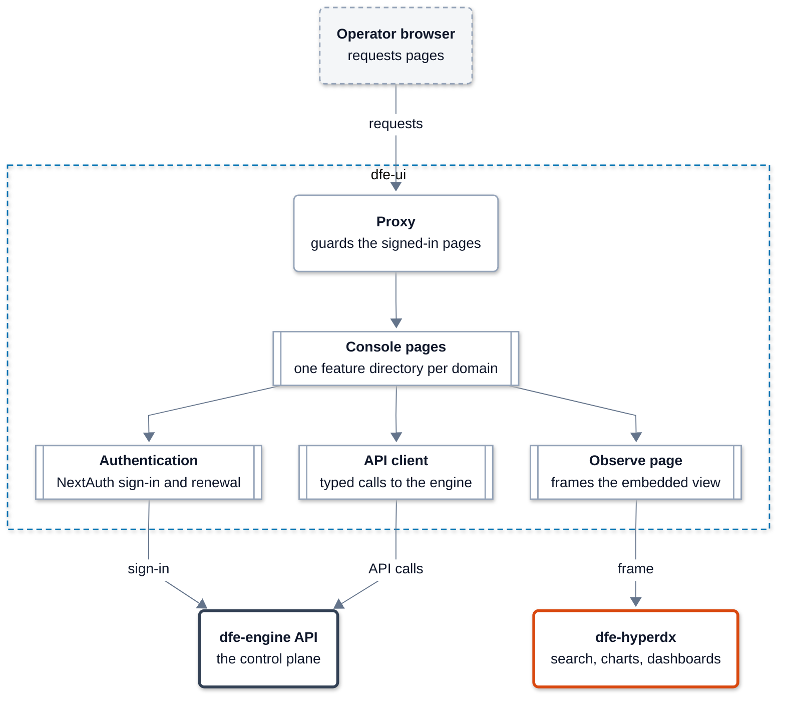

# dfe-ui architecture

dfe-ui is the DFE console, the Next.js app an operator signs in to, and it reads and writes through one backend, the dfe-engine API. It keeps no datastore and frames dfe-hyperdx for search, charts and dashboards.

*Figure 1. L3 Components -- dfe-ui. The browser is outside dfe-ui.* Up: top of dfe-ui. Down: [L4 Detail -- Console pages](console-and-the-flow.md), [L4 Detail -- Authentication](authentication.md), [L4 Detail -- API client](engine-api-client.md), [L4 Detail -- Observe page](observe-embed.md).

## How data flows

1. The **Proxy** takes every request for a signed-in page. It checks the session, then the forced password change, then asks the engine for the setup status. When the engine does not answer it rewrites the request to the engine-unavailable page.
2. The **Console pages** render the domain the operator opened, one feature directory per domain.
3. **Authentication** signs the operator in, renews the session and signs out, all against the engine.
4. Every engine call from feature code goes through the **API client**. Feature code makes no raw fetch.
5. The **Observe page** frames dfe-hyperdx, which authenticates the operator from the `dfe_token` cookie the proxy plants.

The calls that skip the client all run on the server: the NextAuth sign-in and session helpers, and the `getAuthPermissions` and `getSetupStatus` server actions. The NextAuth, health and metrics routes skip the proxy.

## Components

| Part           | Role                                                                                                                                  | Page                                           |
| -------------- | ------------------------------------------------------------------------------------------------------------------------------------- | ---------------------------------------------- |
| Proxy          | `src/proxy.ts`: the auth guard, the setup redirect, the `dfe_token` cookie and the Content-Security-Policy                             | this page                                      |
| Console pages  | `src/app`: route group `(auth)` for the signed-in app, `(no-auth)` for login, first-run setup, the forced password change and outage | [console-and-the-flow.md](console-and-the-flow.md) |
| Authentication | `src/app/api/auth/[...nextauth]/route.ts` and `src/core/config/auth.ts`: sign-in, renewal and sign-out against the engine             | [authentication.md](authentication.md)         |
| API client     | `src/core/config/api`: the one typed client, with TanStack Query hooks per endpoint                                                    | [engine-api-client.md](engine-api-client.md)   |
| Observe page   | `src/app/(auth)/observe/[[...feature]]/page.tsx`: frames dfe-hyperdx in chromeless mode                                              | [observe-embed.md](observe-embed.md)           |

Paths are relative to `apps/dfe-core-ui/`.

## External dependencies

| Dependency     | Needed for                                                                 | Swappable                                                                    |
| -------------- | -------------------------------------------------------------------------- | ---------------------------------------------------------------------------- |
| dfe-engine API | Every read and write, sign-in and the setup status                         | No. The console exposes the engine API and never reaches past it             |
| dfe-hyperdx    | The Observe page                                                           | No                                                                           |
| An OIDC IdP    | Single sign-on, when the deployment uses it. The engine runs the handshake | Any OIDC provider the engine is configured for                               |

## Deployment variants

One artifact ships: the `ghcr.io/hyperi-io/dfe-ui` container, with a thin Helm chart built from `deploy/contract.json`. The same image runs in every profile.

- On Kubernetes, dfe-infra pins the image by tag and digest in `versions.yaml`, and Argo CD deploys the chart.
- On Docker, dfe-docker runs the same image in its compose profiles.
- In local development the app runs from a checkout with `yarn workspace dfe-core-ui dev` against a local engine on port 8003 ([local-development.md](local-development.md)).

dfe-hyperdx sits on its own subdomain. The `dfe_token` cookie is set on the shared parent domain, `DFE_COOKIE_DOMAIN`, so the frame can read it.

## Design considerations

| Aspect      | How it is handled                                                                                                                                                                     |
| ----------- | ------------------------------------------------------------------------------------------------------------------------------------------------------------------------------------- |
| Security    | The proxy sets the Content-Security-Policy and guards every signed-in page. Scope gating (`RbacProtected`) hides routes and single buttons the operator's role lacks. Identity always comes from the engine |
| Reliability | A failed setup-status call goes to the engine-unavailable page, never read as setup complete                                                                                          |
| Operations  | `/livez`, `/readyz` and `/metrics` on port 3000 sit outside the proxy, so a probe without a session gets a real answer                                                              |
| Performance | A large schema import pages its rendering and validates every row ([create-schema-form.md](create-schema-form.md))                                                                    |

## Why it's built this way

| Decision                       | Reason                                                                                                                                         |
| ------------------------------ | ---------------------------------------------------------------------------------------------------------------------------------------------- |
| No datastore                   | The engine is the one source of truth. When the console needs data, the engine grows an endpoint                                               |
| One typed client               | The endpoint map is compile-checked against types generated from the engine's OpenAPI spec, so a route the spec drops fails the build, not the user |
| Frame dfe-hyperdx              | Search, charts and dashboards come from dfe-hyperdx in chromeless mode, so the console shell owns navigation without rebuilding them                |
| Sign-in through the engine     | For OIDC the engine is the relying party, and the console signs in with the token the engine re-mints, never the provider's |

## Diagram map

- Figure 1. L3 Components -- dfe-ui (this page)
  - [L4 Detail -- Console pages](console-and-the-flow.md)
    - [L4 Detail -- Source flow card](console-and-the-flow.md#the-source-page-draws-the-engines-flow-resolver)
    - [L4 Detail -- Uploaded row lifecycle](create-schema-form.md#how-a-row-moves-from-import-to-submit)
  - [L4 Detail -- Authentication](authentication.md)
  - [L4 Detail -- API client](engine-api-client.md)
  - [L4 Detail -- Observe page](observe-embed.md)
- [L4 Detail -- Workspace packages](../CONTRIBUTING.md#where-things-live)
- [L4 Detail -- Build and deploy](build-and-deploy.md)
- [L4 Detail -- Local console and engine](local-development.md)

## What's next

- [Build and deploy](build-and-deploy.md): the image, the chart and the release
- [Local development](local-development.md): running the console against a local engine
- [CONTRIBUTING.md Context](../CONTRIBUTING.md#context): where things live, the workspace packages, and the commands that test a change
