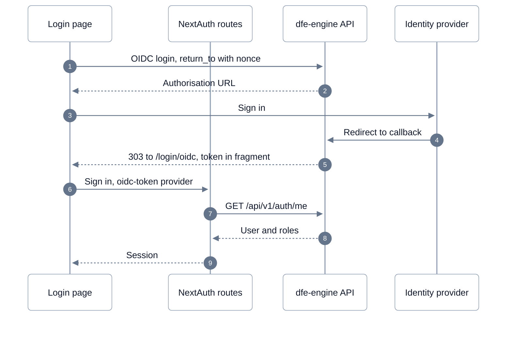

# Authentication

Authentication signs an operator in, renews the session and signs out, all against the engine, and is one part of [dfe-ui](architecture.md).

| Fact       | Value |
| ---------- | ----- |
| Repo       | `hyperi-io/dfe-ui`, `apps/dfe-core-ui/src/app/api/auth/[...nextauth]/route.ts` and `apps/dfe-core-ui/src/core/config/auth.ts` |
| Image      | `ghcr.io/hyperi-io/dfe-ui`, with the thin chart built from `deploy/contract.json` |
| Config     | `NEXTAUTH_URL`, `NEXTAUTH_SECRET`, `INTERNAL_API_URL` and `DFE_COOKIE_DOMAIN` |
| Endpoints  | `/api/auth/*`, the NextAuth routes, outside the proxy |
| Metrics    | the app's process metrics on `/metrics`, port 3000. Nothing specific to this part |

Two ways to sign in, both wired through NextAuth. The console never runs an identity provider handshake itself: identity always comes from the engine.

*Figure 1. L4 Detail -- OIDC sign-in. Solid arrows are requests, dashed arrows are answers.* Up: [L3 Components -- dfe-ui](architecture.md).

## Sign-in goes through the engine

A local account signs in on the login form, which posts to the engine's local login (`POST /api/v1/auth/login`) and then reads the roles from `GET /api/v1/auth/me`. The console forwards the browser's `X-Forwarded-For`, so the engine's audit trail can name the client.

For OIDC the engine is the relying party, and the console signs in with the token the engine re-mints, never the provider's.

The login page stores a nonce in `sessionStorage` before it leaves for the provider, and the return URL has the same nonce as `login_nonce`. The console rejects the token unless the two match, so a crafted link with someone else's token cannot sign a browser in. A login the engine rejects comes back the same way with the refusal's code instead (`#error=no_role_granted`), and the sign-in form says why. The code picks fixed words in `apps/dfe-core-ui/src/core/config/loginRefusal.ts`, so a link cannot put text on the page.

## Sessions renew and end at the engine

The browser asks for a renewal by posting to `/api/auth/session` with no token data. The server refreshes the session's engine token against the engine, reads the roles from `/api/v1/auth/me`, and takes the expiry and the password-change flag from the engine's answer. Nothing the browser sends can set the token, roles, lifetime or flag. A renewal the engine rejects marks the session expired, and the console signs out to the login page. That covers a session the engine has ended (`session_ended`) and one past its maximum age (`session_expired`).

Changing a password asks for the current one as well. On the forced first-login screen that is the password the deployment issued. A wrong one is marked on the field (`invalid_current_password`). The engine ends every session of the account on a change, so the console signs out and the login page says to sign in with the changed password.

`apps/dfe-core-ui/src/app/api/auth/[...nextauth]/route.ts` wraps NextAuth's sign-out. Once NextAuth has cleared its session, the route asks the engine to end every session of the account (`POST /api/v1/auth/logout`) with the session's token, before the response reaches the browser. An engine that is down, or too old to have the route, does not stop the local sign-out. The same route expires the `dfe_token` cookie, which `apps/dfe-core-ui/src/proxy.ts` sets from the session's engine token, scoped to `DFE_COOKIE_DOMAIN`, so the embedded dfe-hyperdx signs in as the same user. A renewal replants that cookie, and sign-out expires it with the same Domain and Path, along with the host-only copy the engine's OIDC callback sets.

Every post-login redirect goes through `safeRedirectPath` (`apps/dfe-core-ui/src/core/config/loginCallback.ts`), including NextAuth's `redirect` callback. A target that resolves off the console's origin, such as `//host`, `/\host` or another scheme, becomes `/`. Key files: `apps/dfe-core-ui/src/proxy.ts`, `apps/dfe-core-ui/src/core/config/auth.ts`, `apps/dfe-core-ui/src/core/auth/renewEngineSession.ts`, `apps/dfe-core-ui/src/core/auth/oidcLoginNonce.ts` and the `(no-auth)` login page. The suite-wide auth model, with dfe-engine as the one place access is decided, is in dfe-engine's [OIDC and RBAC architecture](https://github.com/hyperi-io/dfe-engine/blob/main/docs/control-plane/oidc-rbac-architecture.md).
