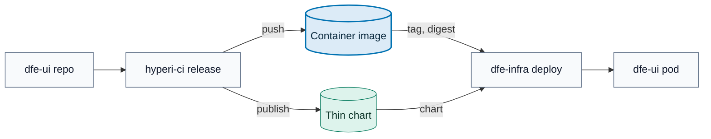

# Build and deploy

One shipped artifact: the `dfe-core-ui` Next.js app as a standalone-output container, published by hyperi-ci to `ghcr.io/hyperi-io/dfe-ui` with a thin Helm chart built from its deployment contract. The workspace packages are bundled into the app at build, and none is published to npm (`release.destinations.npm: false` in `.hyperi-ci.yaml`).

A release reaches a running pod as one image and one chart.

*Figure 1. L4 Detail -- Build and deploy. The blue box is the one artifact this repo ships.* Up: [dfe-ui documentation](README.md).

- Build: `yarn build` (turbo). The app uses Next standalone output with `outputFileTracingRoot` at the monorepo root, so the container has only what the app needs.
- Container: a three-stage `Dockerfile`. The builder installs and runs `yarn build`, `app_tree` assembles the standalone output with `.next/static` and `public/` beside it, and `runner` is the slim runtime that runs as uid 1001. `NEXT_PUBLIC_*` variables are inlined at BUILD time, and the image bakes `NEXT_PUBLIC_API_URL` as empty, so the browser calls the engine on the console's origin. Everything else the app reads at runtime comes from ordinary env vars ([observe-embed.md](observe-embed.md) has the embed case).
- Publish: in CI, hyperi-ci pushes the image to `ghcr.io/hyperi-io/dfe-ui` and the thin chart to its OCI chart registry. `make build` wraps `hyperi-ci run build`. semantic-release derives the version from the commits, so the version is never bumped by hand.
- Deploy: dfe-infra deploys the thin chart with its integration values for the app (`argocd/values/apps/dfe-ui/values.yaml` in dfe-infra) and then the deploy repo's instance values file, which the engine writes. dfe-infra's `versions.yaml` pins the image tag and digest.
- Deployment contract: `deploy/contract.json` (scalo-service contract schema v4) declares the port, probes, run-as identity, NextAuth secret and scaling the chart renders the pod from. Keep `security` in step with the Dockerfile `USER` and `health` with the route handlers.
- Headers: every page leaves `apps/dfe-core-ui/src/proxy.ts` with a Content-Security-Policy with a fresh script nonce, which is why no page is prerendered. `apps/dfe-core-ui/next.config.ts` adds `X-Content-Type-Options: nosniff`, `Referrer-Policy: strict-origin-when-cross-origin` and `X-Frame-Options: DENY` to every response and drops `X-Powered-By`. A proxy in front must pass these through rather than replace them.
