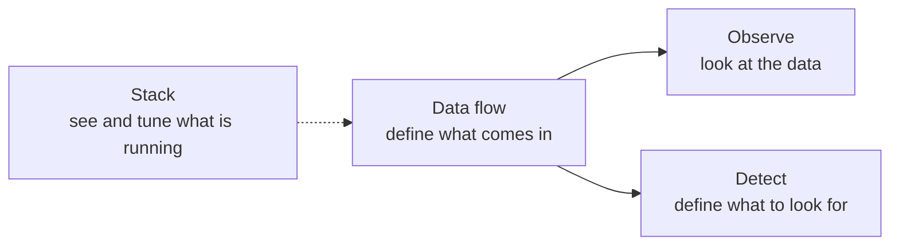
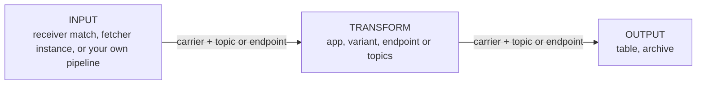

# How the console maps to the flow

A record enters DFE, is optionally transformed, and lands in a table. The console's menu groups follow that flow: Data flow defines what comes in, Detect what to look for in it, Observe is where the landed data is read, and Stack is what is running.

## The four groups

Each group is one RBAC family: a heading appears exactly when at least one
destination under it is the signed-in user's.

| Group     | Destinations                                                     | Route                                                                                              | What the user does there                               | RBAC family                                    |
| --------- | ---------------------------------------------------------------- | -------------------------------------------------------------------------------------------------- | ------------------------------------------------------ | ---------------------------------------------- |
| Observe   | Search, Saved Searches, Chart Explorer, Dashboards, Hunt Results | `/observe/search`, `/observe/search/list`, `/observe/chart`, `/observe/dashboards`, `/observe/hunt-results` | look at the data                                       | `dashboard_read`                               |
| Data flow | Sources, Meta Schemas, Library                                   | `/sources`, `/schemas`, `/library`                                                                 | define what comes in, its fields, where it lands       | `source_*`, `schema_*`, `library_*`            |
| Detect    | Rules, Hunts                                                     | `/rules`, `/hunts`                                                                                 | define what to look for                                | `rule_*`, `hunt_*`                             |
| Stack     | Components, Admin Tools                                          | `/components`, `/admin-tools`                                                                      | see and tune what is running                           | `deployment_read`, `helmvars_read`, `helmvars_write`, `deployment_admin_links_read` |

The Observe destinations are dfe-hyperdx embeds and appear only once a dfe-hyperdx URL
is configured.

Settings and Platform are not in the menu. The settings button in the header
opens them, at `/settings/admin` and `/settings/platform`. Some routes have no
menu entry either: `/sources/ingest-rules`, `/schemas/meta-schemas`,
`/schemas/other-schemas`, `/field-maps`, `/transforms`, `/account`, and the
first-run `/setup/[step]`.

## The Source page follows the flow

A source's own page opens on its Flow tab: three stages and the two arrows between them. The `main` source, and a source with no meta schema or not yet deployed, shows no Transform stage.

Every value on that card comes from `GET /api/v1/sources/{name}/flow`, which
returns the engine's own flow resolver. The compilers write each app's deployed
config from the same resolver, so the drawing and the running stack are one
answer rather than two implementations of a naming convention. The console
never builds a topic name or an endpoint of its own.

Three things follow from reading the resolver rather than the source's fields:

- The card shows the effective transport, never the declared one. A source that names no transport takes the deployment's default, and the card says which.
- A refusal is the engine's own sentence. When a source's stages cannot run as declared (archiving where the archiver does not carry the transport, a transform app that does not carry it, a transport the deployment does not offer) the resolver answers 422 and the card shows that message verbatim.
- Engine-owned stages are read-only. A fetcher instance and a transform instance are derived from the source, so the card marks them engine-owned and links to the app's page under `/components` rather than offering an edit that would be recompiled away.

With no source named in the URL, the Sources page opens the `main` source, where every record the receiver cannot place lands. So the card draws that default flow before anyone has defined a source. An engine with no `main` source shows an empty panel instead.

## Where a source's transport and archive are set

Both live on the source form's first tab, beside the name:

- Transport: leave it empty to inherit the deployment default, or pick one the deployment offers, `bus` or `direct`. The engine refuses at save a flow its resolver cannot run.
- Archive: keep the raw record as it arrived. The archiver reads the landing topic, so this needs the bus.

## Reading an app's manifest rather than naming it

The Stack destinations render from `GET /api/v1/apps`, whose entries come from
the app manifest. Nothing in the console is keyed to an app's name:

- `multiplicity` decides where an app appears. A `single` app serves every source and belongs to the fleet. A `per_config` app belongs to its source and appears on that source's page.
- `file_sets` decides whether an app instance gets a Files panel at all.
- `has_compiled_routing` decides whether a source page shows the app's routing card. That card is read-only, because the routing is compiled from the sources, and offers Sync routing when the deployed routing has drifted from them.
