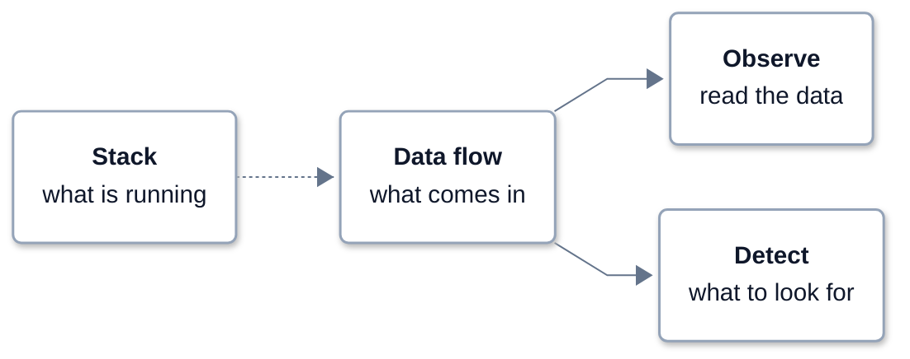

# Console pages

The console pages are the screens an operator works in, one feature directory per domain, and are one part of [dfe-ui](architecture.md).

| Fact       | Value |
| ---------- | ----- |
| Repo       | `hyperi-io/dfe-ui`, `apps/dfe-core-ui/src/app` and `apps/dfe-core-ui/src/{Sources,Schemas,Rules,...}` |
| Image      | `ghcr.io/hyperi-io/dfe-ui`, with the thin chart built from `deploy/contract.json` |
| Config     | none of their own: each domain reads the engine through the API client |
| Endpoints  | route group `(auth)` for the signed-in app, `(no-auth)` for login, setup, the forced password change and the engine-unavailable page |
| Metrics    | the app's process metrics on `/metrics`, port 3000. Nothing specific to this part |

A record enters DFE, is optionally transformed, and lands in a table. The console's menu groups follow that flow: Data flow defines what comes in, Detect what to look for in it, Observe is where the landed data is read, and Stack is what is running.

Data flow feeds both Observe and Detect, and Stack runs the apps behind it.

*Figure 1. L4 Detail -- Console menu groups. The dotted arrow is Stack running and tuning the apps, not data moving.* Up: [L3 Components -- dfe-ui](architecture.md).

A heading appears when at least one destination under it is the signed-in user's. The sidebar lists Observe first, then Data flow, Detect and Stack (`apps/dfe-core-ui/src/core/components/SidebarMenu/SidebarMenu/constants.tsx`).

| Group     | Destinations                                                     | Route                                                                                                        | What the user does there                         | RBAC family                                                                         |
| --------- | ---------------------------------------------------------------- | ------------------------------------------------------------------------------------------------------------ | ------------------------------------------------ | ----------------------------------------------------------------------------------- |
| Observe   | Search, Saved Searches, Chart Explorer, Dashboards               | `/observe/search`, `/observe/search/list`, `/observe/chart`, `/observe/dashboards`                           | look at the data                                 | `dashboard_read`                                                                    |
| Data flow | Sources, Meta Schemas, Library                                   | `/sources`, `/schemas`, `/library`                                                                           | define what comes in, its fields, where it lands | `source_*`, `schema_*`, `library_*`                                                 |
| Detect    | Rules, Hunts, Detections, Field Maps                             | `/rules`, `/hunts`, `/observe/hunt-results`, `/field-maps`                                                   | define what to look for, and read what hunts found | `rule_*`, `hunt_*`, `dashboard_read` (Detections), `fieldmap_*`                   |
| Stack     | Components, Admin Tools                                          | `/components`, `/admin-tools`                                                                                | see and tune what is running                     | `deployment_read`, `helmvars_read`, `helmvars_write`, `deployment_admin_links_read` |

The Observe destinations are dfe-hyperdx embeds and appear once a dfe-hyperdx URL is configured.

Settings and Platform are not in the menu. The settings button in the header opens them, at `/settings/admin` and `/settings/platform`. Some routes have no menu entry either: `/sources/ingest-procedures`, `/schemas/meta-schemas`, `/schemas/other-schemas`, `/field-maps`, `/account`, and the first-run `/setup/[step]`.

## The Source page draws the engine's flow resolver

A source's page opens on its Flow tab: three stages and the two arrows between them. The `main` source, and a source with no meta schema or not yet deployed, shows no Transform stage.

The Flow tab draws a source's input, transform and output, with the carrier and target on each arrow.

```mermaid
---
config:
  theme: base
  look: neo
  fontFamily: Inter, -apple-system, Segoe UI, Roboto, Helvetica, Arial, sans-serif
  flowchart:
    curve: linear
    nodeSpacing: 40
    rankSpacing: 64
    padding: 18
    wrappingWidth: 280
    htmlLabels: true
  elk:
    preset: modelOrder
  themeVariables:
    fontSize: 15px
    lineColor: "#64748B"
    primaryTextColor: "#0F172A"
    clusterBorder: "#0072B2"
    edgeLabelBackground: "#FFFFFF"
  themeCSS: >-
    p{margin:0}
    .node[data-look] rect,.node[data-look] path,.node[data-look] polygon,.node[data-look] .outer-path{filter:drop-shadow(0 1px 2px rgba(15,23,42,.10)) drop-shadow(0 6px 14px rgba(15,23,42,.10))}
    .node rect{rx:10px;ry:10px}
    .cluster rect{rx:16px;ry:16px}
    .node .label div{min-width:150px}
    .node.decision .label div{min-width:0}
    .cluster[data-look] rect{filter:none}
    .nodeLabel{line-height:1.35}
    .nodeLabel b{font-weight:600;font-size:15px;letter-spacing:-0.01em}
    .nodeLabel span{font-size:12.5px;font-weight:400;color:#334155}
    .cluster-label span.nodeLabel{display:inline-block;background:#FFFFFF;color:#0B2A3F;border:1.5px solid #0072B2;border-radius:999px;padding:2px 12px;font-size:11.5px;font-weight:700;letter-spacing:.09em;text-transform:uppercase}
    .flowchart-link{stroke-width:1.75px}
    .labelBkg{background:transparent!important}
    span.edgeLabel{display:inline-block;background:#FFFFFF!important;color:#1E293B;border:1px solid #94A3B8;border-radius:999px;padding:2px 10px;font-size:12px;font-weight:500}
    span.edgeLabel p{background:transparent!important}
    .label-icon{width:20px;height:20px;vertical-align:-4px;margin-right:6px}
    .ingest .label-icon{color:#0E8A7D}
    .xform .label-icon{color:#7B4FB0}
    .load .label-icon{color:#0072B2}
    .bus .label-icon{color:#A8517F}
    .store .label-icon{color:#00785A}
    .ui .label-icon{color:#D9480F}
    .ext .label-icon{color:#64748B}
---
flowchart LR
  accTitle: L4 Detail -- Source flow card
  accDescr: The Flow tab draws an Input, a Transform and an Output stage. Each arrow between two stages names the carrier and the topic or endpoint the records move on.
  input("<b>Input</b><br/><span>where records come from</span>")
  transform("<b>Transform</b><br/><span>shapes the records</span>")
  output("<b>Output</b><br/><span>where records land</span>")
  input --> transform
  transform --> output
  classDef ext fill:#F4F6F8,stroke:#94A3B8,stroke-width:1.5px,stroke-dasharray:5 4,color:#0F172A
  classDef ingest fill:#FFFFFF,stroke:#0E8A7D,stroke-width:3px,color:#0F172A
  classDef xform fill:#FFFFFF,stroke:#7B4FB0,stroke-width:3px,color:#0F172A
  classDef load fill:#FFFFFF,stroke:#0072B2,stroke-width:3px,color:#0F172A
  classDef bus fill:#FFFFFF,stroke:#A8517F,stroke-width:3px,color:#0F172A
  classDef store fill:#FFFFFF,stroke:#00785A,stroke-width:3px,color:#0F172A
  classDef ui fill:#FFFFFF,stroke:#D9480F,stroke-width:3px,color:#0F172A
  classDef decision fill:#FFFFFF,stroke:#9A6700,stroke-width:3px,color:#0F172A
  classDef error fill:#FFFFFF,stroke:#C2410C,stroke-width:3px,color:#0F172A
  classDef control fill:#FFFFFF,stroke:#334155,stroke-width:3px,color:#0F172A
  classDef part fill:#FFFFFF,stroke:#94A3B8,stroke-width:1.5px,color:#0F172A
  class input,output part
  class transform xform
```

*Figure 2. L4 Detail -- Source flow card.* Up: [L3 Components -- dfe-ui](architecture.md).

| Stage     | Shows                                                                                                                                                 |
| --------- | ----------------------------------------------------------------------------------------------------------------------------------------------------- |
| Input     | The receiver match, the fetcher instance, or the topic your pipeline writes, with the origin and the transport.                                      |
| Transform | The app, its variant and its endpoint or topics. For your pipeline, the topics it reads and writes, its consumer group and its lag in records.       |
| Output    | The table, the topic or endpoint the loader reads it from, and whether the archive keeps the raw record.                                             |

The stages, transport and targets on that card come from `GET /api/v1/sources/{name}/flow`, which returns the engine's flow resolver, and the lag of your pipeline from `GET /api/v1/sources/{name}/lag`. The compilers write each app's deployed config from the same resolver, so the drawing and the running stack are one answer. The console never builds a topic name or an endpoint itself (`apps/dfe-core-ui/src/Sources/components/ViewSourceTabs/SourceFlowTabContent/flowStages.ts`). Three things follow:

- The card shows the effective transport, never the declared one. A source that names no transport takes the deployment's default, and the card says which.
- A refusal is the engine's sentence. When a source's stages cannot run as declared (archiving where the archiver does not have the transport, a transform app that does not have it, a transport the deployment does not offer) the resolver answers 422 and the card shows that message verbatim.
- Engine-managed stages are read-only. A fetcher instance and a transform instance are derived from the source, so the card marks them engine-owned and links to the app's page under `/components` rather than offering an edit that would be recompiled away.

With no source in the URL, the Sources page opens the `main` source, where every record the receiver cannot place lands. So the card draws that default flow before anyone has defined a source.

Transport and archive are set on the source form's first tab, beside the name:

- Transport: leave it empty to inherit the deployment default, or pick one the deployment offers, `bus` or `direct`. The engine rejects at save a flow its resolver cannot run.
- Archive: keep the raw record as it arrived. The archiver reads the landing topic, so this needs the bus.

## The Stack pages read the app manifest

The Stack destinations render from `GET /api/v1/apps`, and its entries come from the app manifest. These fields, not the app's name, decide what the console draws:

- `multiplicity` decides where an app appears. A `single` app serves every source and belongs to the fleet. A `per_config` app belongs to its source and appears on that source's page.
- `file_sets` decides whether an app instance gets a Files panel at all.
- `has_compiled_routing` decides whether a source page shows the app's routing card. That card is read-only, because the routing is compiled from the sources, and offers Sync routing when the deployed routing has drifted from them.
