# `CreateSchemaForm` (dfe-core-ui)

`apps/dfe-core-ui/src/core/components/CreateSchemaForm` builds a schema from its metadata fields plus columns, and pages the uploaded columns so a large import stays usable. Columns come from a manual table or from a CSV or Elastic index template upload. The full column lists live in React context for promotion and submit, and the uploaded table renders the current page of rows alone.

## Component map

Paths are relative to the component directory.

| Piece                                                               | Role                                                                                                                                         |
| ------------------------------------------------------------------- | -------------------------------------------------------------------------------------------------------------------------------------------- |
| `CreateSchemaForm` (`index.tsx`)                                    | Ant Design `Form` with `preserve`, the metadata fields, the submit guards. Clears the form-level error banner on every change.               |
| `CreateSchemaFormProvider` (`contexts/CreateSchemaForm.context.tsx`) | Holds `uploadedSchemaColumns`, `invalidUploadedSchemaColumns` and `schemaColumns`, with refs for synchronous reads, promotion and removal. |
| `SchemaUploadCollapse` (`SchemaUploadCollapse/index.tsx`)           | Upload type (DFE CSV or JSON), the file section, and the column tabs.                                                                        |
| `SchemaUploadFileSection` (`SchemaUploadCollapse/SchemaUploadFileSection.tsx`) | Calls `convertCsv` (CSV) or `useElasticConvert` (JSON) and hands the rows to `handleSetUploadedSchemaColumns`.                    |
| `UploadedSchemaTable` (`UploadedSchemaTable/index.tsx`)             | Every uploaded column, invalid ones included: an `AddSchemaTable` over `uploadedColumns`, searchable, paged at 50 rows by default. Renders `InvalidColumnsTable` above it when there are invalid rows. |
| `InvalidColumnsTable` (`InvalidColumnsTable/index.tsx`)             | Rows that fail `rowSchema`, in a separate `Form.List` (`invalidColumns`), unpaged, each dropped from the list once it parses.       |
| `AddSchemaTable` (`AddSchemaTable/index.tsx`)                       | `Form.List` plus table. Syncs the list from `initialValues` when a `JSON.stringify` signature of those values changes.                       |

## How a row moves from import to submit

An uploaded row is valid or invalid from import, and submit is blocked while any row is invalid.

```mermaid
---
config:
  theme: base
  look: neo
  fontFamily: Inter, -apple-system, Segoe UI, Roboto, Helvetica, Arial, sans-serif
  themeVariables:
    fontSize: 15px
    lineColor: "#64748B"
    primaryTextColor: "#0F172A"
    edgeLabelBackground: "#FFFFFF"
    actorBkg: "#FFFFFF"
    actorBorder: "#94A3B8"
    actorTextColor: "#0F172A"
    actorLineColor: "#94A3B8"
    signalColor: "#64748B"
    signalTextColor: "#0F172A"
    sequenceNumberColor: "#FFFFFF"
    noteBkgColor: "#FFFFFF"
    noteBorderColor: "#94A3B8"
    noteTextColor: "#0F172A"
    labelBoxBkgColor: "#FFFFFF"
    labelBoxBorderColor: "#94A3B8"
    labelTextColor: "#0F172A"
    loopTextColor: "#0F172A"
  themeCSS: >-
    p{margin:0}
    .labelBkg{background:transparent!important}
    span.edgeLabel{display:inline-block;background:#FFFFFF!important;color:#1E293B;border:1px solid #94A3B8;border-radius:999px;padding:2px 10px;font-size:12px;font-weight:500}
    span.edgeLabel p{background:transparent!important}
    .messageText{fill:#0F172A;stroke:#FFFFFF;stroke-width:4px;paint-order:stroke;stroke-linejoin:round}
    .loopText,.loopText tspan{fill:#0F172A;stroke:#FFFFFF;stroke-width:4px;paint-order:stroke;stroke-linejoin:round}
    .loopLine{stroke:#64748B}
    .actor{rx:10px;ry:10px;filter:drop-shadow(0 1px 2px rgba(15,23,42,.10)) drop-shadow(0 6px 14px rgba(15,23,42,.10))}
    .actor-line{stroke-dasharray:4 4}
---
stateDiagram-v2
  direction LR
  accTitle: L4 Detail -- Uploaded row lifecycle
  accDescr: A converted row is parsed on import. A row that parses is valid and one that fails is invalid. An invalid row is fixed or removed, and submit runs when no row is invalid, parsing every row again.
  [*] --> Imported: file converted
  Imported --> Valid: passes
  Imported --> Invalid: fails
  Invalid --> Valid: fixed
  Invalid --> [*]: removed
  Valid --> Submitted: none invalid
  Submitted --> [*]
  classDef error fill:#FFFFFF,stroke:#C2410C,stroke-width:3px,color:#0F172A
  classDef part fill:#FFFFFF,stroke:#94A3B8,stroke-width:1.5px,color:#0F172A
  class Imported,Valid,Submitted part
  class Invalid error
```

*Figure 1. L4 Detail -- Uploaded row lifecycle. Orange is a row that failed `rowSchema`.* Up: [L3 Components -- dfe-ui](architecture.md#the-console-is-five-parts).

1. Import. `SchemaUploadFileSection` converts the file (`transformDataToUploadedSchemaRow`) and passes the rows to `handleSetUploadedSchemaColumns`, which runs `rowSchema.safeParse` per row. Every row goes into `uploadedSchemaColumns`, and the rows that fail are listed in `invalidUploadedSchemaColumns` with their Zod issues.
2. Form lists. `AddSchemaTable` uses `useLayoutEffect` to `setFieldsValue` its `Form.List` when the `initialValues` signature changes, so a parent passing a new array each render does not reset the list.
3. Promotion, two paths. `InvalidColumnsTable` watches `invalidColumns` (`Form.useWatch` plus `useEffect`) and promotes each row that parses after the edit. `handleUpdateUploadedSchemaColumns`, reached from the form's `onValuesChange` through `handleFormValuesChange`, merges live form rows with the invalid payloads by row `id` and promotes those that parse. Both validate the moved paths in a `queueMicrotask`.
4. Submit. `onFinish` runs `rowSchema.safeParse` over every `uploadedSchemaColumns` entry and every non-blank `schemaColumns` entry from context, and blocks the submit when any fails or `invalidUploadedSchemaColumns` is not empty.

## Paging limits rendering, not validation

The uploaded table passes `pagination` to the table, so rows off the current page do not mount their `Form.Item`s. The form's `preserve` keeps list values when rows unmount as the user pages. The authoritative full lists for submit are the context arrays and the `safeParse` in `onFinish`, never the visible cells.

`InvalidColumnsTable` and the manual `schemaColumns` table ("Schema Columns" with no upload, "Additional Columns" beside one) are not paged, so a large invalid set or a large manual schema renders every row at once. A file cleaned before upload leaves fewer rows in the unpaged invalid table.

## What costs time on a large import

- Whole-form parses. Every `Form.Item` rule from `useAntdZodResolver` (`apps/dfe-core-ui/src/core/utils/zod/useAntdZodResolver.ts`) asks for a parse of the whole form. Calls with deep-equal values share the last parse, but each check runs `isEqual` over the form and each fresh parse takes a `cloneDeep` snapshot, so every edit costs one full parse plus a deep compare and a deep copy of every column.
- Signatures. `AddSchemaTable` builds `JSON.stringify(initialValues)` on every render.
- Repeat parses. Each row is parsed at import and again at submit.
- Mounted tabs. Both `SchemaUploadCollapse` tabs set `forceRender: true`, so the uploaded and manual tables stay mounted together.

CSV conversion (`convertCsv`, a server action) and Elastic conversion (`useElasticConvert`, an engine call) run before any of this, so a payload or timeout limit there fails before paging can help.

## What breaks if a change ignores the model

- Two sources of truth. Editing flows through Ant Design `Form.List`, and the arrays for promotion and submit live in context. The helpers keep them aligned on promotion and removal, so a change that writes one side and not the other lets them diverge.
- Effect order. Promotion runs partly from `useWatch` plus `useEffect` and partly from `onValuesChange`, and `validateFields` runs after both in a microtask. Reordering them changes which errors show.
- The change filter. `onValuesChange` work for the column lists is skipped unless `changedValuesMayAffectTabLists` (`contexts/CreateSchemaForm.context.helpers.tsx`) says the change touches `schemaColumns`, `uploadedColumns` or `invalidColumns`.
- Row ids. Promotion and removal match rows by `id`, carried in a hidden `Form.Item`. A row without a stable `id` cannot be promoted or removed.

Before adding another `Form.Item` with `formValidation` on a column row, weigh that each edit re-parses the whole form. A scoped validator on that path costs less. Paging or virtualising `InvalidColumnsTable` would match the uploaded table, provided promotion and removal still match by `id`.
