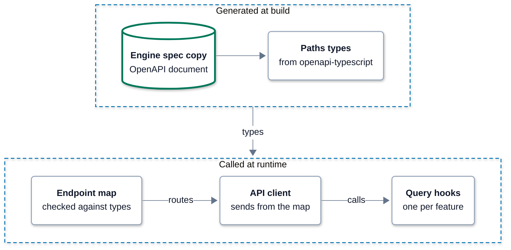

# API client

The API client is the one typed client every engine call from feature code goes through, and is one part of [dfe-ui](architecture.md).

| Fact       | Value |
| ---------- | ----- |
| Repo       | `hyperi-io/dfe-ui`, `apps/dfe-core-ui/src/core/config/api` |
| Image      | `ghcr.io/hyperi-io/dfe-ui`, with the thin chart built from `deploy/contract.json` |
| Config     | `NEXT_PUBLIC_API_URL` for the browser and `INTERNAL_API_URL` for the server |
| Endpoints  | none of its own. It calls the dfe-engine API |
| Metrics    | the app's process metrics on `/metrics`, port 3000. Nothing specific to this part |

The endpoint map sits between the generated types and the client, so a route the spec drops fails compilation there.

*Figure 1. L4 Detail -- API client. Feature code calls the engine through the client alone.* Up: [L3 Components -- dfe-ui](architecture.md).

Feature code reaches the engine through one typed client generated from the engine's OpenAPI spec. The endpoint map is compile-time checked against the generated types, so a route that disappears from the spec fails the build, not the user.

## The spec becomes typed calls

- Engine spec: `packages/dfe-engine-types/specs/openapi.json` and `openapi.e2e.json`, committed byte copies of dfe-engine's `openapi/openapi.json` and `openapi/openapi.e2e.json`.
- Generated code: `yarn workspace @repo/dfe-engine-types generate` runs openapi-typescript over both specs (`types/index.d.ts`, `types/e2e.d.ts`) and writes the scope and limit constants (`scopes/index.ts`, `limits/index.ts`).
- Endpoint map: `apps/dfe-core-ui/src/core/config/api/endpoints/index.ts`, typed `satisfies Record<string, Record<string, keyof paths>>`, so every entry must exist in the spec.
- Client: `apps/dfe-core-ui/src/core/config/api/client.ts`, a fetch wrapper adding auth, JSON handling and `ApiError`.
- Hooks: feature directories wrap endpoints in TanStack Query.

## The engine opens the sync PR

A push to dfe-engine's main that changes either spec runs its Sync dfe-engine-types workflow ([sync-dfe-engine-types.yml](https://github.com/hyperi-io/dfe-engine/blob/main/.github/workflows/sync-dfe-engine-types.yml) in dfe-engine). It copies both specs here, runs `generate`, and opens a `sync-dfe-engine-types-<sha>` pull request, closing any older one. The compile errors that PR raises in the endpoint map are the drift check working.

To do the same by hand against a local engine checkout:

1. Copy dfe-engine's `openapi/openapi.json` and `openapi/openapi.e2e.json` over the two files in `packages/dfe-engine-types/specs/`.
2. `yarn workspace @repo/dfe-engine-types generate`
3. Fix any compile errors in the endpoint map.

The spec's `info.version` moves with every engine release, because each release commit rewrites `openapi/openapi.json`. A version comparison detects drift between releases but not edits within one, so compare the files. The type-safety sync is documented engine-side in [type-safety-sync.md](https://github.com/hyperi-io/dfe-engine/blob/main/docs/control-plane/type-safety-sync.md).
