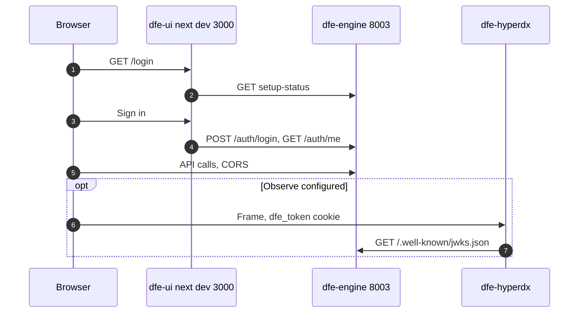

# Local development

The app runs as a plain `next dev` process against a local dfe-engine -- no containers, no Kubernetes. Node >= 24 with corepack (yarn 4), turbo drives the workspaces. Bring the engine up first, then one command boots the console.

## Boot the engine first, then the app

The engine is the one backend the console needs. Run it as a local process on port 8003 per [dfe-engine docs/local-dev.md](https://github.com/hyperi-io/dfe-engine/blob/main/docs/local-dev.md), then:

```bash
corepack enable   # once -- the repo pins yarn 4 via packageManager
yarn install
NEXT_PUBLIC_API_URL=http://localhost:8003 \
INTERNAL_API_URL=http://localhost:8003 \
NEXTAUTH_URL=http://localhost:3000 \
NEXTAUTH_SECRET=any-dev-value \
yarn workspace dfe-core-ui dev --port 3000
```

If `corepack enable` fails with `EACCES` (a system-installed node cannot symlink into `/usr/bin`), give it a writable directory on your PATH -- `corepack enable --install-directory ~/.local/bin` -- or run every yarn command through corepack (`corepack yarn install`), which needs no enable. Skipping corepack and using a yarn 1 from your PATH runs the wrong yarn against this lockfile.

The app answers on <http://localhost:3000>. Port 3000 is not a habit -- the CORS allowlist a dev engine falls back to breaks the console on any other port (see the gotchas). `yarn dev` (turbo) runs the same app when you do not need to pass a port.

Sign in at `/login` with an engine account. On a fresh dev engine that is the bootstrap `admin` on the engine's shipped default password (`_DEFAULT_PASSWORD` in dfe-engine's `src/dfe_engine/auth/bootstrap.py`). Until initial setup completes, every signed-in page redirects to the `/setup` first-run wizard, after the forced password change when the account has one.

Two curls check both halves, no browser needed. `ADMIN_PASSWORD` is the engine admin's password:

```bash
curl -s -X POST http://localhost:8003/api/v1/auth/login \
  -H 'Content-Type: application/json' \
  -d "{\"username\":\"admin\",\"password\":\"${ADMIN_PASSWORD}\"}"
# -> a JSON body with access_token, expires_in, user_id and roles

curl -s -o /dev/null -w '%{http_code}\n' http://localhost:3000/login
# -> 200
```

Then check it as a user: open <http://localhost:3000/login>, sign in, and land in the app (the `/setup` wizard on a fresh engine).

The rest of the daily loop:

```bash
yarn test                                   # the app's vitest suite, through turbo
yarn lint                                   # eslint via turbo
yarn workspace dfe-core-ui storybook        # component workbench, port 6006
yarn workspace @repo/dfe-icons storybook    # icon gallery, port 6007
```

The engine's API spec arrives here by pull request from the engine. [engine-api-client.md](engine-api-client.md) has that and the manual sync. The Playwright suite is in [apps/dfe-core-ui/e2e/README.md](../apps/dfe-core-ui/e2e/README.md), and contribution mechanics (commit format, DCO, local CI) are in [CONTRIBUTING.md](../CONTRIBUTING.md).

## The browser and the server both talk straight to the engine

The browser fetches the engine cross-origin (CORS), the Next server calls it server-side, and NextAuth mints the session from the engine's login endpoint (`POST /api/v1/auth/login`, then `GET /api/v1/auth/me` for roles). The engine issues the tokens (`https://dfe.local/api` by default) and publishes its ES384 keys at `/.well-known/jwks.json`. The embedded dfe-hyperdx trusts those keys, reading the `dfe_token` cookie `apps/dfe-core-ui/src/proxy.ts` plants.

Locally the browser calls the engine directly, beside the calls `next dev` makes for it.



*Figure 1. L4 Detail -- Local console and engine.* Up: [dfe-ui documentation](README.md).

The dfe-hyperdx frame is optional for console work. Wiring it up is covered in [observe-embed.md](observe-embed.md) and the fork's [getting-started doc](https://github.com/hyperi-io/dfe-hyperdx/blob/main/docs/development/getting-started.md).

Every deployment fact is an environment variable.

| Variable                                            | When               | Purpose                                                                                    |
| --------------------------------------------------- | ------------------ | ------------------------------------------------------------------------------------------ |
| `NEXT_PUBLIC_API_URL`                               | build-time inlined | engine base URL for browser-side fetches                                                   |
| `INTERNAL_API_URL`                                  | runtime            | engine base URL for server-side fetches (the proxy, NextAuth, server actions)              |
| `NEXTAUTH_URL` / `NEXTAUTH_SECRET`                  | runtime            | NextAuth session config -- any non-empty secret works for dev                              |
| `DFE_COOKIE_DOMAIN`                                 | runtime            | parent domain for the `dfe_token` cookie -- leave unset locally                            |
| `HYPERDX_URL` / `HYPERDX_PORT`                      | runtime            | the embed pair, either variable -- see [observe-embed.md](observe-embed.md)                |
| `OTEL_EXPORTER_OTLP_ENDPOINT` / `OTEL_SERVICE_NAME` | runtime            | OTLP export of the console's telemetry, off when the endpoint is unset or empty            |
| `LOG_LEVEL`                                         | runtime            | server log threshold, scalo-py's names from `TRACE` to `CRITICAL`, default `INFO`          |
| `LOG_FORMAT`                                        | runtime            | `json` or `text`. Unset writes JSON in production or with an OTLP endpoint, text otherwise |

`NEXT_PUBLIC_*` values are baked in at build time -- `next dev` reads them at boot, so changing one needs a dev-server restart (a production image needs a rebuild). `next dev` loads a gitignored `apps/dfe-core-ui/.env.local` if present, and explicit shell values win over it (Next.js env precedence). `apps/dfe-core-ui/.env.example` lists the rest, the session-refresh timings among them.

Two ports matter, and 3000 matters most:

| Port | Owner             | Notes                                                                |
| ---- | ----------------- | -------------------------------------------------------------------- |
| 3000 | dfe-ui `next dev` | must be 3000, 5173 or 5174 unless the engine's CORS list is extended |
| 8003 | dfe-engine API    | Swagger at `/docs`, JWKS at `/.well-known/jwks.json`                 |

## The gotchas that bite

- A non-default port breaks the console quietly. An engine on `DFE_ENGINE_ENV=dev` that names no CORS origins allows `http://localhost:3000`, `:5173` and `:5174` and nothing else. On any other port every browser call to the engine fails its CORS check, starting with `/api/v1/auth/setup-status` on the login page, so the OIDC option is missing and signed-in pages cannot load their data. Set the engine's `DFE_ENGINE_API_CORS_ORIGINS` (comma-separated) or stay on port 3000.
- A fresh engine bounces `/` to `/setup`. `apps/dfe-core-ui/src/proxy.ts` asks the engine's setup-status on every signed-in request. Until initial setup completes, every signed-in page redirects to the wizard -- that is first-run behaviour, not a fault.
- No engine reads as an error page, served as 200. With no engine running, `/login`, `/setup` and every signed-in page read "Cannot reach the DFE engine", with a Try again button. A page cannot set its status, so the proxy rewrites the request to `/engine-unavailable`. The rewrite asks for a 503, but Next serves a rewrite with the target page's status, so the HTTP answer is 200. Monitor the engine, not this page. A refused connection, an engine that says nothing within `ENGINE_CALL_TIMEOUT_MS` (`apps/dfe-core-ui/src/core/config/engineTimeout.ts`) and a 502, 503 or 504 count as no answer. An unset engine URL is a different fault. With both `INTERNAL_API_URL` and `NEXT_PUBLIC_API_URL` unset, `/login` and the signed-in shell name it ("The engine URL is not configured") instead of failing. The image bakes `NEXT_PUBLIC_API_URL` as empty, so there an unset `INTERNAL_API_URL` is enough.
- One dev server per checkout. Next.js refuses a second `next dev` for the same app directory and exits with "Another next dev server is already running".

## Running natively on a Mac, in VS Code

The console and the engine run as plain processes. The Rust apps stay in docker or kind. To check a machine, one command, one PASS or FAIL line and one log file to paste back:

```bash
python3 scripts/macos-dev-smoke.py   # engine from ../dfe-engine, or DFE_ENGINE_DIR=<path>
uv run --no-project python scripts/macos-dev-smoke.py   # the same, under uv's Python
```

It wants `uv`, node 24 and a dfe-engine checkout beside this repo, and prints what is missing with the install line. Docker (OrbStack or Docker Desktop) is optional. With it the engine gets a local ClickHouse. Without it the pages that read ClickHouse fail and the rest work.

In VS Code, Run and Debug has an `Engine + Console` compound (`Engine + Console (local ClickHouse)` when docker is up). It asks once for the engine checkout, `../dfe-engine` by default. Run the `Engine: e2e seed (setup complete)` task, then sign in at <http://localhost:3000> as `initial_user` with the engine's well-known e2e password (`_WELL_KNOWN_E2E_PASSWORD` in dfe-engine's `src/dfe_engine/api/e2e/seed/accounts.py`).

Two Mac traps. Point the console at `127.0.0.1:8003`, not `localhost`, because Node resolves `localhost` to `::1` first and the engine listens on IPv4 alone. And leave ports 5000 and 7000 alone, macOS holds them for AirPlay Receiver. The `macOS dev smoke` workflow runs the same script on a GitHub macOS arm64 runner, with no ClickHouse because that runner has no docker, and a Linux leg runs its docker mode. Dispatch it with an engine tag and a ui tag (or `main`) to gate a release candidate. Any other ref is refused before a checkout.
