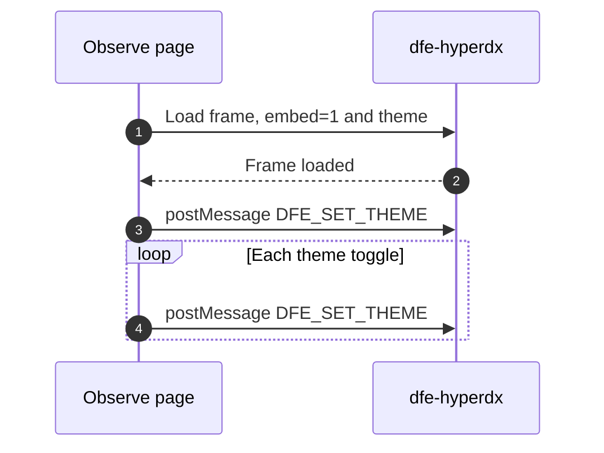

# Observe page

The Observe page frames dfe-hyperdx inside the console, and is one part of [dfe-ui](architecture.md).

| Fact       | Value |
| ---------- | ----- |
| Repo       | `hyperi-io/dfe-ui`, `apps/dfe-core-ui/src/app/(auth)/observe/[[...feature]]/page.tsx` |
| Image      | `ghcr.io/hyperi-io/dfe-ui`, with the thin chart built from `deploy/contract.json` |
| Config     | `HYPERDX_URL` or `HYPERDX_PORT`, and `DFE_COOKIE_DOMAIN` for the shared cookie |
| Endpoints  | `/observe`, `/observe/dashboards`, `/observe/hunt-results` |
| Metrics    | the app's process metrics on `/metrics`, port 3000. Nothing specific to this part |

`/observe/[[...feature]]` (`apps/dfe-core-ui/src/app/(auth)/observe/[[...feature]]/page.tsx`) frames dfe-hyperdx in chromeless mode (`?embed=1`), so the dfe-ui shell owns navigation and dfe-hyperdx provides search, charts and dashboards over the data in ClickHouse. The page maps its path to the dfe-hyperdx route (`/observe` to `/search`, `/observe/dashboards` to `/dashboards/list`, `/observe/hunt-results` to `/search?source=hunts`) and passes its query parameters on. The dashboards page shows the usage headline above the frame.

The page keeps the frame's theme in step with the console by posting it when the frame loads and on every toggle.

*Figure 1. L4 Detail -- Observe embed. The page posts the theme only once the frame has loaded.* Up: [L3 Components -- dfe-ui](architecture.md).

The frame signs in from the `dfe_token` cookie the proxy plants ([authentication.md](authentication.md#sessions-renew-and-end-at-the-engine)).

## HYPERDX_URL or HYPERDX_PORT points the frame at dfe-hyperdx

One runtime mechanism, two ways to reach dfe-hyperdx. The `(auth)` layout reads both values per request and hands them to `HyperdxContext`. `useHyperdxUrl()` is the one source the frame URL and the sidebar gating read.

| Variable       | Points at                                                                                                                    |
| -------------- | ---------------------------------------------------------------------------------------------------------------------------- |
| `HYPERDX_URL`  | dfe-hyperdx on a separate hostname (k8s gateway: `https://hyperdx.{domain}`). Wins when set.                                    |
| `HYPERDX_PORT` | Same host, different port (docker compose). Host comes from `window.location`, so it is correct for localhost and LAN alike. |

Neither is `NEXT_PUBLIC_`, because a build-inlined read would bake the build machine's value into the browser bundle. With neither set, `/observe` renders "Search is not configured for this deployment."

The console's Content-Security-Policy frames nothing but dfe-hyperdx: `frame-src` is `HYPERDX_URL`'s origin, or the host the browser used on `HYPERDX_PORT`. dfe-hyperdx reached any other way is blocked in the browser.

dfe-hyperdx creates a rule from a search through its `/dfe/create-rule` route, which forwards to the engine, and opens `/rules/{id}` in another tab. dfe-ui holds no listener for it ([hyperdx-rule-create.md](hyperdx-rule-create.md)).
