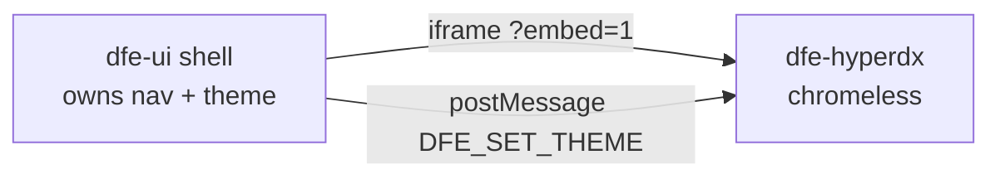

# The /observe embed - the Observe explore surface

`/observe/[[...feature]]` iframes dfe-hyperdx in chromeless mode
(`?embed=1`) so the dfe-ui shell owns navigation while dfe-hyperdx provides the
Kibana-style explore over ALL DFE data in ClickHouse. Theme changes are
pushed into the iframe via a `DFE_SET_THEME` postMessage.

## How it is configured

One runtime mechanism, two deployment shapes. The `(auth)` layout reads both
values per request and hands them to `HyperdxContext`; `useHyperdxUrl()` is
the single source the iframe URL and the sidebar gating read.

| Variable       | Shape                                                                                                                        |
| -------------- | ---------------------------------------------------------------------------------------------------------------------------- |
| `HYPERDX_URL`  | dfe-hyperdx on its own hostname (k8s gateway: `https://hyperdx.{domain}`). Wins when set.                                        |
| `HYPERDX_PORT` | Same host, different port (docker compose). Host comes from `window.location`, so it is correct for localhost and LAN alike. |

Neither is `NEXT_PUBLIC_`, and that is deliberate: a build-inlined read would
bake the build machine's value into the browser bundle. With neither set,
`/observe` renders "Search is not configured for this deployment."

The console's Content-Security-Policy frames nothing but dfe-hyperdx: `frame-src` is `HYPERDX_URL`'s origin, or the host the browser used on `HYPERDX_PORT`. dfe-hyperdx reached any other way is blocked in the browser.

## Rule-create round trip

dfe-hyperdx creates the rule through its `dfe/create-rule` route, which
forwards to the engine, and opens `/rules/{id}` in a new tab. dfe-ui holds no listener for it. Detail:
[hyperdx-rule-create.md](hyperdx-rule-create.md).
